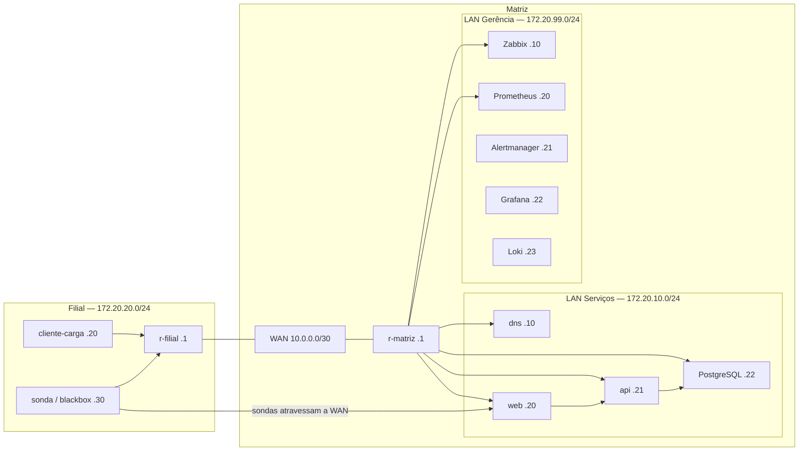

# Café Planalto — laboratório de redes e observabilidade

Implementação do trabalho prático do PDF [Trabalho_Pratico_Monitoramento_Zabbix_Prometheus_Grafana.pdf](./Trabalho_Pratico_Monitoramento_Zabbix_Prometheus_Grafana.pdf). A aplicação, o gerador de carga, a configuração dos serviços e a automação auxiliar são escritos em Python quando apropriado; Nginx, roteadores e plataformas de monitoramento usam suas configurações nativas.

## O que está incluído

- Topologia Docker Compose com roteadores Linux, WAN, LAN de serviços, LAN de gerência e LAN da filial. Rotas são aplicadas automaticamente ao subir o ambiente.
- Loja em três camadas: Nginx, API FastAPI instrumentada e PostgreSQL.
- Endpoints `GET /produtos`, `POST /pedidos`, `GET /health`, `GET /metrics` e `POST /admin/caos`.
- Logs JSON, métricas RED e de negócio, pool PostgreSQL e gerador contínuo de carga Python (8 req/s por padrão).
- Zabbix 7.0 LTS, banco, frontend e agentes; provisionamento por API de hosts, templates, cenário web, mapa, itens ICMP e dependências da filial.
- Prometheus, regras de alerta, Alertmanager, blackbox exporter na filial, exporters de PostgreSQL, Nginx, host e contêineres.
- Recording rule versionada para requisições/segundo, usada no painel RED.
- Grafana provisionado por arquivos com painéis USE, RED, negócio, SLO e orçamento de erro.
- Loki e Promtail para centralização de logs. O painel RED tem link para explorar erros no Loki.
- Encaminhador de notificações Python; suporta Telegram ou webhook do Discord sem credenciais versionadas.

## Requisitos para executar

- Linux com Docker Engine e Docker Compose v2.
- Recomendado: 4 vCPU, 8 GB de RAM livres e 40 GB de disco, como no enunciado. O conjunto completo é pesado; feche outros laboratórios antes de iniciar.
- A coleta do Promtail usa `/var/lib/docker/containers`, portanto o laboratório completo foi desenhado para Docker Engine em Linux (uma VM Linux é a opção recomendada também no Windows/macOS).

## Subida

```bash
cp .env.example .env
# Edite .env: troque todas as senhas/tokens de laboratório antes de iniciar.
docker compose up -d --build
```

O comando acima constrói e inicia toda a infraestrutura. O serviço `zabbix-provision` autentica na API do frontend e configura hosts, templates, cenário web e mapa. A primeira inicialização pode levar alguns minutos enquanto os bancos são criados.

```bash
docker compose ps
docker compose logs -f zabbix-provision
```

Se o provisionamento do Zabbix falhar, a falha fica explícita nos logs. Depois de corrigir a causa, repita com `make provision`. O frontend padrão usa `Admin` / `zabbix`; altere a senha no primeiro acesso e sincronize `ZABBIX_ADMIN_PASSWORD` no `.env` antes de executar o provisionador.

### Interfaces locais

| Serviço | URL | Acesso inicial |
|---|---|---|
| Loja | http://127.0.0.1:8080 | sem autenticação (somente loopback) |
| Grafana | http://127.0.0.1:3000 | `admin` / valor de `GRAFANA_ADMIN_PASSWORD` |
| Zabbix | http://127.0.0.1:8081 | `Admin` / `zabbix` |
| Prometheus | http://127.0.0.1:9090 | sem autenticação (somente loopback) |
| Alertmanager | http://127.0.0.1:9093 | sem autenticação (somente loopback) |

As portas publicadas ficam limitadas a `127.0.0.1`; não exponha o laboratório à Internet.

## Arquitetura e endereçamento



| Segmento | Endereçamento | Elementos principais |
|---|---|---|
| WAN matriz–filial | `10.0.0.0/30` | r-matriz `10.0.0.1`, r-filial `10.0.0.2` |
| Serviços | `172.20.10.0/24` | gateway `.1`, DNS `.10`, web `.20`, API `.21`, DB `.22` |
| Gerência | `172.20.99.0/24` | gateway `.1`, Zabbix `.10`, Prometheus `.20`, Alertmanager `.21`, Grafana `.22`, Loki `.23` |
| Filial | `172.20.20.0/24` | gateway `.1`, carga `.20`, sonda `.30` |
| Gerência fora de banda (somente roteadores) | `172.30.0.0/24` | r-matriz `.2`, r-filial `.3` |

O Docker precisa de um endereço de gateway para cada bridge. Por isso, a bridge de transporte usa `10.0.0.0/29` no host Docker; no startup, cada roteador substitui seu endereço `/29` atribuído pelo Docker pelo endereço WAN `/30` da topologia lógica. Assim, r-matriz usa `10.0.0.1/30` e r-filial `10.0.0.2/30`, sem manter dois prefixos para o mesmo endereço. A interface de gerência fora de banda existe apenas nos roteadores; Prometheus e Zabbix não estão conectados a ela. Coletores e sondas usam rotas pelo plano de dados.

| Equipamento | Destino | Próximo salto |
|---|---|---|
| r-matriz | `172.20.20.0/24` | `10.0.0.2` |
| r-filial | `172.20.10.0/24` | `10.0.0.1` |
| r-filial | `172.20.99.0/24` | `10.0.0.1` |
| Hosts de serviços | `172.20.20.0/24`, `172.20.99.0/24` | `172.20.10.1` |
| Hosts da filial | `172.20.10.0/24`, `172.20.99.0/24` | `172.20.20.1` |
| Hosts de gerência | `172.20.10.0/24`, `172.20.20.0/24` | `172.20.99.1` |

Os containers usam `route-init` em um namespace de rede compartilhado para aplicar as rotas estáticas. As interfaces dos roteadores são nomeadas `eth0` (OOB), `eth1` (WAN), `eth2` (primeira LAN); assim os comandos de falha do enunciado continuam previsíveis. DNS da zona `cafeplanalto.lab` é servido pelo CoreDNS.

## Verificação rápida

```bash
make validate
make test
make demo
docker exec clab-cafeplanalto-cliente-carga ip route
docker exec clab-cafeplanalto-cliente-carga dig loja.cafeplanalto.lab
docker exec clab-cafeplanalto-cliente-carga traceroute -n 172.20.10.20
curl -s http://127.0.0.1:8080/metrics | grep -E 'http_requests_total|pedidos_criados_total|pedidos_valor_reais_total|db_pool_conexoes_em_uso'
```

O traceroute da filial deve mostrar r-filial e r-matriz antes da loja. O DNS interno resolve a loja para `172.20.10.20`.

## Falhas para ensaio

Configure `.env` e use o token administrativo definido em `ADMIN_TOKEN`. `make chaos-latency`, `make chaos-errors` e `make chaos-reset` ativam latência, 20% de respostas 500 e recuperação. Para testar o banco e o WAN:

```bash
# Banco indisponível e recuperação
docker stop clab-cafeplanalto-db
docker start clab-cafeplanalto-db

# Queda e recuperação do enlace WAN; a WAN é eth1 nos roteadores
docker exec clab-cafeplanalto-r-filial ip link set eth1 down
docker exec clab-cafeplanalto-r-filial ip link set eth1 up

# Remover e restaurar a rota estática (r-matriz)
docker exec clab-cafeplanalto-r-matriz ip route del 172.20.20.0/24
docker exec clab-cafeplanalto-r-matriz ip route add 172.20.20.0/24 via 10.0.0.2

# Simular latência/perda e limpar o qdisc no final
docker exec clab-cafeplanalto-r-filial tc qdisc add dev eth1 root netem delay 300ms loss 5%
docker exec clab-cafeplanalto-r-filial tc qdisc del dev eth1 root

# DNS fora / recuperação
docker stop clab-cafeplanalto-dns
docker start clab-cafeplanalto-dns
```

Sempre reverta a falha injetada antes de encerrar o ensaio. Pare o ambiente sem apagar os dados com `docker compose down`; volumes são preservados.

## Alertas e notificações

Alertmanager agrupa e envia alertas recuperados/resolvidos ao serviço Python `notifier`. Configure **um** canal real em `.env` (`TELEGRAM_BOT_TOKEN` + `TELEGRAM_CHAT_ID` ou `DISCORD_WEBHOOK_URL`) e recrie os serviços com `docker compose up -d notifier`. O provisionador cria também a mídia e a ação Telegram do Zabbix quando as duas variáveis Telegram estão preenchidas; depois rode `make provision`. Sem canal, o notifier registra um aviso no log local, não envia para fora. A senha de administrador inicial do Zabbix é `zabbix`; troque-a na interface e atualize `ZABBIX_ADMIN_PASSWORD` no `.env`.

## Limites conhecidos / validação ao vivo

- O provisionador importa templates oficiais embarcados no Zabbix 7.0; confirme os templates e a versão exibidos no log durante a primeira subida. Se os nomes dos templates variarem na imagem atual, ajuste as candidatas em `zabbix/provision/provision.py` e rode `make provision`.
- O Zabbix provisiona SNMP, descoberta por template, monitoramento ICMP, dependência dos hosts da filial, cenário HTTP em dois passos e um mapa. O tráfego de interfaces SNMP é descoberto pelo template oficial; valide a descoberta após alguns ciclos.
- O Prometheus coleta a VM Docker pelo node_exporter e os recursos dos containers pelo cAdvisor. Não confunda métricas da VM com métricas individuais de roteador: Zabbix/SNMP e blackbox cobrem os elementos de rede.
- O dashboard SLO calcula janelas móveis de sete dias, alinhadas à retenção do Prometheus. Em um laboratório recém-iniciado, os valores representam apenas o período desde o início da coleta.
- Traces OpenTelemetry/Tempo e Zabbix Proxy são bônus e não fazem parte desta entrega.
- O canal real de alerta requer credenciais fornecidas pela dupla e não pode vir preenchido no repositório.

## Desenvolvimento Python

```bash
python3 -m venv .venv
. .venv/bin/activate
pip install -r requirements-dev.txt
make test
```

## Arquivos relevantes

- `compose.yaml`: topologia, serviços e endereços.
- `app/main.py`: API, acesso PostgreSQL, logs e métricas.
- `app/load_generator.py`: cliente contínuo da filial.
- `prometheus/`, `alertmanager/`, `grafana/`, `loki/`: regras, provisionamento e painéis em código.
- `zabbix/provision/`: provisionamento automatizado via API JSON-RPC.
- `report.md`: relatório técnico editável para completar com evidências do ensaio.
