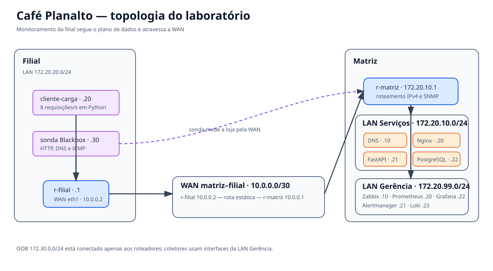

# Relatório técnico — Café Planalto

**Disciplina:** Projeto e Administração de Redes — IFBA, campus Vitória da Conquista  
**Trabalho:** Monitoramento e observabilidade com Zabbix, Prometheus e Grafana  
**Versão do laboratório:** 1.0  
**Observação:** este relatório descreve a solução configurada. Os resultados numéricos e capturas dependem da execução na VM da dupla e devem ser preenchidos após os ensaios, sem inventar medições.

## 1. Resumo executivo

A proposta reproduz a matriz, a filial e a loja virtual da Café Planalto em contêineres Docker Compose. O caminho da filial até a loja passa por dois roteadores Linux e por uma WAN `10.0.0.0/30`, com rotas estáticas. A loja tem Nginx, API FastAPI e PostgreSQL. O cliente de carga e a sonda Blackbox ficam na filial para observar a disponibilidade e a latência do ponto de vista do usuário remoto.

O Zabbix é usado prioritariamente para hosts, interfaces SNMP, ICMP, agentes e cenário web. Prometheus, Alertmanager, Grafana e Loki formam a plataforma de métricas, alertas, painéis e logs. As duas pilhas coletam do mesmo ambiente, mas com objetivos diferentes. Arquivos versionados descrevem infraestrutura, regras, provisionamento, dashboards e aplicação.

**Conclusões do ensaio:** preencher depois de subir a topologia: data/hora, duração de cada cenário, início/fim do alerta, causa identificada, recuperação e consultas/painéis que evidenciaram o diagnóstico.

## 2. Arquitetura, endereçamento e roteamento

| Segmento | Rede | Hosts e endereços |
|---|---|---|
| WAN | `10.0.0.0/30` | r-matriz `10.0.0.1`, r-filial `10.0.0.2` |
| LAN Serviços | `172.20.10.0/24` | gateway `.1`, DNS `.10`, web `.20`, API `.21`, DB `.22` |
| LAN Gerência | `172.20.99.0/24` | gateway `.1`, Zabbix `.10`, Prometheus `.20`, Alertmanager `.21`, Grafana `.22`, Loki `.23` |
| LAN Filial | `172.20.20.0/24` | gateway `.1`, carga `.20`, sonda `.30` |
| Gerência fora de banda (roteadores) | `172.30.0.0/24` | r-matriz `.2`, r-filial `.3` |

O Docker Compose precisa de um gateway em cada bridge. A bridge que transporta o enlace usa `10.0.0.0/29` no nível Docker; no startup, cada roteador substitui o endereço `/29` atribuído pelo Docker pelo endereço WAN `/30` da topologia lógica requerida. O restante do laboratório usa os endereços definidos no enunciado.

| Rota estática | Próximo salto | Configuração |
|---|---|---|
| r-matriz → `172.20.20.0/24` | `10.0.0.2` | `ip route replace` no startup do roteador |
| r-filial → `172.20.10.0/24` | `10.0.0.1` | `ip route replace` no startup do roteador |
| r-filial → `172.20.99.0/24` | `10.0.0.1` | `ip route replace` no startup do roteador |
| Hosts Serviços → LAN Filial e Gerência | `172.20.10.1` | serviço `route-init-*` |
| Hosts Filial → LAN Serviços e Gerência | `172.20.20.1` | serviço `route-init-*` |
| Hosts Gerência → LAN Serviços e Filial | `172.20.99.1` | serviço `route-init-*` |

O roteamento IPv4 é habilitado nos roteadores. A interface OOB só é anexada aos roteadores; Zabbix e Prometheus ficam na LAN Gerência, portanto o caminho de observação da filial atravessa a WAN. A zona DNS `cafeplanalto.lab` contém os nomes dos serviços e da loja.

## 3. Aplicação e instrumentação

O Nginx expõe a loja e encaminha para a API. A API usa FastAPI e um pool async de PostgreSQL. O catálogo e os pedidos são persistidos; a operação de pedido usa transação, valida o produto e calcula o valor em centavos para evitar erros de arredondamento.

| Endpoint | Comportamento |
|---|---|
| `GET /produtos` | Retorna catálogo persistido no PostgreSQL |
| `POST /pedidos` | Valida produto/quantidade, grava pedido e responde `201` |
| `GET /health` | Retorna sucesso somente se `SELECT 1` funcionar |
| `GET /metrics` | Exporta métricas Prometheus |
| `POST /admin/caos` | Controla latência artificial e fração de respostas 500, protegido por token |

As métricas incluem total e duração por rota/método/status, pedidos, faturamento e conexões em uso no pool. IDs de pedido/usuário não são labels. Logs são JSON em stdout e contêm horário UTC, nível, rota, status, duração e trace ID correlacionável quando o cabeçalho está presente. O cliente Python da filial executa uma mistura de catálogo e pedidos, a 8 requisições/segundo por padrão.

## 4. Estratégia de observabilidade

### 4.1 Zabbix

O Zabbix 7.0 LTS monitora os hosts Linux por Zabbix Agent 2. Os roteadores têm interfaces SNMPv2c de leitura e são associados a template oficial com descoberta de interfaces. O provisionador via API cria grupo/hosts, itens e triggers ICMP, dependências dos hosts da filial, mapa e cenário web de dois passos (catálogo e pedido). A senha SNMP de laboratório deve ser substituída se houver exposição fora da VM.

O foco é disponibilidade e diagnóstico de rede/infraestrutura. ICMP e SNMP distinguem enlace, roteador e host; agentes e templates apontam serviço e recursos. O cenário web mede a jornada do usuário. Durante a validação, registrar quais interfaces foram descobertas, valores de tráfego/estado e o tempo observado para trigger e recuperação.

### 4.2 Prometheus, Grafana, Alertmanager e Loki

Prometheus coleta API, exporters de PostgreSQL e Nginx, node_exporter da VM, cAdvisor e sondas Blackbox do ponto de vista da filial (HTTP, DNS e ICMP). As regras são versionadas e usam `for` e severidade; uma recording rule de requisições/segundo alimenta o painel RED. Alertmanager agrupa notificações e encaminha ao notifier, que pode entregar a Telegram ou Discord quando a dupla configura os segredos locais. Com Telegram configurado, o provisionador cria também mídia e ação no Zabbix.

O Grafana é provisionado por arquivos: painel USE da VM/containers/sondas, painel RED da API, painel de negócio e dois SLOs. Promtail lê os arquivos de log Docker do host e envia ao Loki. O painel RED oferece ligação de exploração para logs. A coleta usa labels de baixa cardinalidade.

### 4.3 SLOs

1. **Disponibilidade da loja:** 99,5% de amostras válidas da sonda HTTP na filial em uma janela móvel de sete dias. O orçamento total é 0,5% das amostras; o painel apresenta a parcela restante e conta falhas de coleta do Blackbox como indisponibilidade.
2. **Latência:** pelo menos 95% das requisições da API são concluídas em até 300 ms, em janela móvel de sete dias. O orçamento é 5% de requisições acima do limite; o painel calcula a parcela restante.

Os painéis começam sem histórico e não podem afirmar cumprimento do SLO de sete dias antes de acumular dados. Alertas de taxa 5xx, p95 acima de 300 ms e burn rate complementam os SLOs. `ConsumoRapidoOrcamentoErro` usa limiar de burn rate 14,4 sustentado por dois minutos.

## 5. Ensaios de falhas

Preencher a tabela com os resultados reais de cada ensaio; a arquitetura não substitui a demonstração ao vivo.

| Falha | Evidência Zabbix | Evidência Prometheus/Grafana/Loki | Causa e recuperação observadas |
|---|---|---|---|
| Queda WAN | estado/ICMP do r-filial; hosts dependentes sem cascata | `probe_success=0` da filial | Preencher após ensaio |
| Rota removida | ICMP/host inacessível, interface SNMP ainda operacional | sonda de filial indisponível | Diferenciar rota de enlace; preencher |
| Latência/perda WAN | latência e perda ICMP | duração Blackbox e p95 | Preencher |
| PostgreSQL parado | template e agente PostgreSQL | `pg_up`, health 503, erros da API e logs | Preencher |
| API lenta | cenário web lento | p95 e alerta de SLO | Preencher |
| Erros API | cenário/trigger de aplicação | taxa 5xx e logs Loki | Preencher |
| DNS parado | resolução e cenário por nome falham | sonda DNS/HTTP falha | Preencher |

Registrar timestamps de início, notificação, diagnóstico, recuperação e resolução do alerta. Para cada combinação, identificar sintoma e causa sem confundir status do enlace com roteamento.

## 6. Comparação crítica

| Aspecto | Zabbix | Prometheus + Grafana + Loki |
|---|---|---|
| Coleta | Agente ativo/passivo, SNMP, ICMP e cenário web; descoberta e inventário integrados | Pull de exporters e endpoint `/metrics`; sondas blackbox também coletadas por pull |
| Modelo | Itens, hosts, templates, triggers, dependências e mapas | Séries temporais rotuladas, PromQL, regras independentes e dashboards |
| Rede | Mais direto para interfaces SNMP, hosts, ICMP e dependência topológica | Bom para estado/latência visto pelas sondas; precisa exporters ou SNMP exporter para métricas SNMP |
| Aplicação | Cenário web e agentes/templates | Histograma RED, métricas de negócio, dashboards SLO e correlação com Loki |
| Alertas | Adequado a eventos por host e supressão por dependências | Regras declarativas, agrupamento e rotas do Alertmanager; burn rate explícito |
| Aprendizado | Conceitos centralizados em templates/itens e configuração da ferramenta | Requer PromQL, cardinalidade e composição de exporters; configuração como código facilita revisão |
| Logs/traces | Logs não são o foco nativo desta implantação | Loki agrega logs; Tempo/OpenTelemetry não foi incluído nesta versão |
| Recursos | Banco PostgreSQL do Zabbix e processos de servidor/frontend/agents | Prometheus, Loki, Grafana e exporters; retenção Prometheus limitada a sete dias |

**Resultados quantitativos:** medir e preencher uso máximo de RAM/CPU (`docker stats` e node_exporter), tempo de detecção e tempo de provisionamento em uma VM com os recursos informados. Não há medições aqui porque o resultado depende do hardware e da execução da dupla.

## 7. Recomendação à diretoria

Manter Zabbix como ferramenta operacional para disponibilidade de equipamentos, descoberta de interfaces, ICMP, SNMP, agentes e dependências de rede. Usar Prometheus/Grafana para métricas RED/USE, indicadores de negócio, SLOs, alertas por burn rate e visualização consolidada da jornada do cliente; manter Loki para investigação de logs. Os alertas devem representar sintomas acionáveis (loja fora, latência ou erro), enquanto os dados de infraestrutura apoiam a análise da causa.

A operação deve revisar orçamento SLO e notificações periodicamente, limitar retenção conforme a capacidade e validar roteamento de cada coletor. O experimento deve ser refeito ao vivo depois que as falhas tiverem sido restauradas e os alertas resolvidos.

## 8. Reprodutibilidade

O ambiente sobe com `docker compose up -d --build`, com configurações, regras, dashboards e provisionamento versionados. `docker compose down` preserva os volumes; parar/remover os volumes apaga o banco e o histórico e deve ser feito conscientemente. A equipe deve anexar ao relatório final capturas das páginas Targets, dashboards, mapa, cenário web, descoberta SNMP e notificações reais, além das medições e da tabela de ensaios preenchida.
